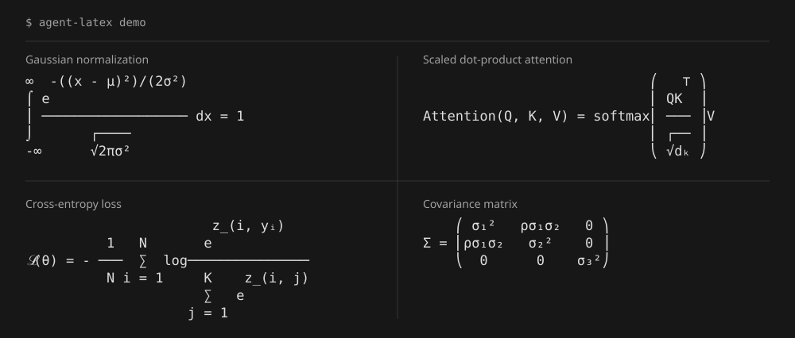

<div align="center">

# Agent-LaTeX

**LaTeX rendering for Claude Code and OpenCode**

[](https://github.com/SeekingVenus/Agent-LaTeX/actions/workflows/ci.yml)

[Quick start](#quick-start) · [Examples](#examples) · [Agent integration](#for-agents-and-scripts) · [CLI reference](docs/cli.md) · [简体中文](README.zh-CN.md)

</div>

Render formulas directly in terminal conversations, from inline notation to
fractions, integrals and matrices. `agent-latex` wraps the existing CLI and
updates the display as output arrives.



## Features

| Feature | Benefit |
| --- | --- |
| **No agent plugins** | Uses the installed Claude Code or OpenCode CLI without agent configuration changes. |
| **Download and run** | Prebuilt Linux and macOS binaries; no Rust toolchain, TeX installation or graphics protocol required. |
| **Automatic rendering** | Formulas render within the conversation, without manual conversion or a separate preview window. |
| **Original text retained** | The agent's saved conversation keeps its source. F12 switches the display between formulas and source. |

Additional commands support Markdown transformation, incremental text streams,
width-aware output and JSON results for scripts.

## Quick start

### 1. Install

**From source** (Rust required):

```sh
git clone https://github.com/SeekingVenus/Agent-LaTeX.git
cd Agent-LaTeX
cargo install --path crates/latex-cli --locked
```

The installed executable is `agent-latex`. Cargo places it in `~/.cargo/bin`.

<details>
<summary>Prebuilt binaries and installer</summary>

Binary installation uses a published [Release](https://github.com/SeekingVenus/Agent-LaTeX/releases)
containing platform archives and `SHA256SUMS`.

Download and extract the Linux or macOS archive matching the system architecture,
or use the installer:

```sh
curl -fsSL https://raw.githubusercontent.com/SeekingVenus/Agent-LaTeX/main/install.sh -o install.sh
sh install.sh SeekingVenus/Agent-LaTeX
export PATH="$HOME/.local/bin:$PATH"
```

The installer selects the platform archive, verifies SHA-256, and installs to
`~/.local/bin`. It does not change shell configuration.

To select a version or installation directory:

```sh
sh install.sh SeekingVenus/Agent-LaTeX v0.1.0
INSTALL_DIR="$HOME/bin" sh install.sh SeekingVenus/Agent-LaTeX
```

</details>

### 2. Configure aliases

```sh
alias cc='agent-latex wrap -- claude'
alias oc='agent-latex wrap -- opencode'
```

Launch either agent with the corresponding alias:

```sh
cc
# or
oc
```

Add the `PATH` setting and aliases to `~/.zshrc` for zsh or `~/.bashrc` for Bash
to retain them in subsequent interactive sessions. Arguments after `cc` or `oc`
are forwarded to the agent.

<details>
<summary>Aliases for a manually downloaded executable</summary>

An absolute path in the alias removes the need to add the executable to `PATH`:

```sh
alias cc='"/absolute/path/to/agent-latex" wrap -- claude'
alias oc='"/absolute/path/to/agent-latex" wrap -- opencode'
```

Replace `/absolute/path/to/agent-latex` with the executable's location. Quoting
preserves paths containing spaces. These aliases work from other directories.

</details>

### 3. Render formulas

The wrapper detects `$...$` inline math and `$$...$$` display math in agent
responses. F12 toggles source display. To use Ctrl+G instead:

```sh
agent-latex config set toggle-key ctrl+g
```

A local formula gallery is available without an agent session or API credentials:

```sh
agent-latex demo
```

The agent's copy command copies source; terminal selection copies visible text.

## Examples

### A single formula

```sh
agent-latex render '\frac{a+b}{c+d}'
```

```text
a + b
─────
c + d
```

Compact single-line output:

```sh
agent-latex render --inline 'x^{n+1}'
# xⁿ⁺¹
```

### A Markdown document

From the repository checkout:

```sh
agent-latex md examples/math.md --plain
```

Use `--plain` for terminal text. Without it, display math is placed in Markdown
text fences to preserve its layout. Inline code and code blocks stay intact.

### Streaming text

```sh
cat examples/math.md | agent-latex live
```

`live` reads plain text or Markdown from stdin. In a terminal it previews open
formulas; in a pipe it emits completed output.

## For agents and scripts

Aliases are intended for interactive shells. Scripts should use the executable
path or an executable available on `PATH`.

Command selection by input and output format:

| Task | Command | Input → output |
| --- | --- | --- |
| Render an expression | `agent-latex render --json` | TeX on stdin → JSON with rendered text and diagnostics |
| Transform a document | `agent-latex md --json notes.md` | Markdown file → JSON with transformed text and statistics |
| Transform stdin | `agent-latex filter --plain` | Markdown on stdin → terminal text |
| Process text deltas | `agent-latex live` | Plain text/Markdown stream → rendered text |
| Launch an interactive agent | `agent-latex wrap -- opencode` | Terminal keyboard input ↔ interactive CLI |

For example:

```sh
printf '%s' '\frac{a}{b}' | agent-latex render --json
```

- `render --json` returns `text`, `width`, `height`, `baseline`, `fallback` and
  `diagnostics`. `fallback` indicates whether the result contains source.
- Use `--width N` to set the output width and `--no-color` for plain text.
- Math delimiters: `$...$`, `\(...\)`, `$$...$$`, `\[...\]`, and fenced
  `math` / `latex` / `tex` blocks in Markdown.
- Decode agent JSON/JSONL events into text before passing them to `live`.
- `wrap` needs a terminal on stdin and stdout. Use `render`, `md` or `filter`
  for automation that reads captured output.

`agent-latex --help` lists commands and options. `agent-latex doctor` reports
terminal settings and prints sample output. The [CLI reference](docs/cli.md)
describes the available options and supported TeX syntax.

## License

[MIT](LICENSE) © agent-latex contributors.
