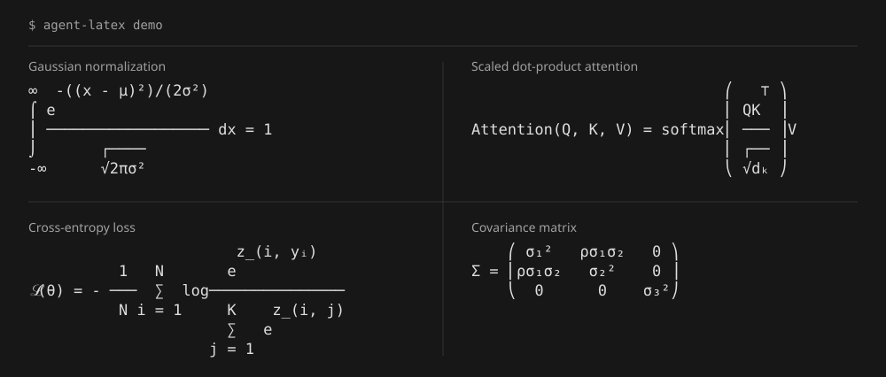

<div align="center">

# Agent-LaTeX

**为 Claude Code 和 OpenCode 提供终端 LaTeX 渲染**

[](https://github.com/SeekingVenus/Agent-LaTeX/actions/workflows/ci.yml)

[快速开始](#快速开始) · [使用示例](#使用示例) · [Agent 集成](#供-agent-和脚本使用) · [命令参考](docs/cli.md) · [English](README.md)

</div>

在终端对话中直接显示数学公式，支持行内符号、分式、积分和矩阵。
`agent-latex` 包装已有的 CLI，随输出更新公式显示。



## 项目特点

| 特点 | 使用收益 |
| --- | --- |
| **无需 agent 插件** | 使用本机已安装的 Claude Code 或 OpenCode，无需修改 agent 配置。 |
| **下载即可运行** | 提供 Linux 和 macOS 预编译文件，无需 Rust 编译工具链、TeX 环境或终端图片协议。 |
| **自动实时渲染** | 在原有对话中显示公式，无需手动转换或打开独立预览窗口。 |
| **保留会话原文** | agent 保存的文本保持原样，F12 可切换公式与源码显示。 |

同时提供 Markdown 转换、文本流增量渲染、输出宽度控制和面向脚本的 JSON 接口。

## 快速开始

### 1. 安装

使用安装脚本下载对应平台的可执行文件：

```sh
curl -fsSL https://raw.githubusercontent.com/SeekingVenus/Agent-LaTeX/main/install.sh -o install.sh
sh install.sh SeekingVenus/Agent-LaTeX
export PATH="$HOME/.local/bin:$PATH"
```

脚本自动选择 Linux 或 macOS 程序包、校验 SHA-256，并安装到 `~/.local/bin`。
运行预编译文件无需 Rust 或 TeX 环境。

<details>
<summary>手动下载、指定版本及源码安装</summary>

**手动下载**：从 [Releases](https://github.com/SeekingVenus/Agent-LaTeX/releases)
下载对应平台的程序包并解压。

**指定版本或安装目录**：

```sh
sh install.sh SeekingVenus/Agent-LaTeX v0.1.3
INSTALL_DIR="$HOME/bin" sh install.sh SeekingVenus/Agent-LaTeX
```

**源码安装**（需要 Rust）：

```sh
git clone https://github.com/SeekingVenus/Agent-LaTeX.git
cd Agent-LaTeX
cargo install --path crates/latex-cli --locked
```

Cargo 默认安装到 `~/.cargo/bin`。二进制安装脚本不修改 shell 配置文件；
需要长期保留的配置见下文别名说明。

</details>

### 2. 配置别名

```sh
alias cc='agent-latex wrap -- claude'
alias oc='agent-latex wrap -- opencode'
```

之后使用对应别名启动：

```sh
cc
# 或
oc
```

将 `PATH` 设置和别名写入 shell 配置文件，可在后续交互式会话中继续使用：
zsh 使用 `~/.zshrc`，Bash 使用 `~/.bashrc`。`cc` 或 `oc` 后附加的参数会传递给 agent。

<details>
<summary>直接使用下载文件的绝对路径设置别名</summary>

别名中使用绝对路径时，无需将可执行文件加入 `PATH`：

```sh
alias cc='"/absolute/path/to/agent-latex" wrap -- claude'
alias oc='"/absolute/path/to/agent-latex" wrap -- opencode'
```

将 `/absolute/path/to/agent-latex` 替换为文件的实际位置。引号用于保留路径中的空格。
配置后可在其他目录直接使用 `cc` 或 `oc`。

</details>

### 3. 渲染公式

包装器自动识别 agent 回复中的 `$...$` 行内公式和 `$$...$$` 独立公式。
F12 用于切换源码显示；如需改用 Ctrl+G：

```sh
agent-latex config set toggle-key ctrl+g
```

也可运行本地示例，无需 agent 会话或 API 凭据：

```sh
agent-latex demo
```

agent 自带的复制命令复制源码，终端选中复制的是可见文本。

## 使用示例

### 渲染一条公式

```sh
agent-latex render '\frac{a+b}{c+d}'
```

```text
a + b
─────
c + d
```

单行输出：

```sh
agent-latex render --inline 'x^{n+1}'
# xⁿ⁺¹
```

### 渲染 Markdown 文档

在仓库目录中执行：

```sh
agent-latex md examples/math.md --plain
```

`--plain` 直接输出终端文本。不加这个选项时，独立公式使用 Markdown 文本代码块
保留排版。原有的行内代码和代码块保持不变。

### 处理流式文本

```sh
cat examples/math.md | agent-latex live
```

`live` 从标准输入接收纯文本或 Markdown。在终端里预览尚未结束的公式，
在管道中输出已经完成的内容。

## 供 agent 和脚本使用

别名用于交互式 shell。脚本应使用可执行文件的路径，或通过 `PATH` 调用。

各命令的输入与输出格式如下：

| 任务 | 命令 | 输入 → 输出 |
| --- | --- | --- |
| 渲染单条公式 | `agent-latex render --json` | 标准输入中的 TeX → 渲染结果和诊断 JSON |
| 转换文档 | `agent-latex md --json notes.md` | Markdown 文件 → 转换文本和统计 JSON |
| 转换标准输入 | `agent-latex filter --plain` | Markdown → 终端文本 |
| 处理文本增量 | `agent-latex live` | 纯文本或 Markdown 流 → 渲染文本 |
| 启动交互式 agent | `agent-latex wrap -- opencode` | 终端键盘输入 ↔ 交互式 CLI |

例如：

```sh
printf '%s' '\frac{a}{b}' | agent-latex render --json
```

- `render --json` 返回 `text`、`width`、`height`、`baseline`、`fallback`
  和 `diagnostics`。通过 `fallback` 判断结果是否退回了源码。
- 使用 `--width N` 指定输出宽度，使用 `--no-color` 输出无颜色文本。
- 数学分隔符支持 `$...$`、`\(...\)`、`$$...$$`、`\[...\]`，
  以及 Markdown 中的 `math` / `latex` / `tex` 代码块。
- agent 的 JSON/JSONL 事件应先解码为文本，再传入 `live`。
- `wrap` 的标准输入和输出都需要连接终端。需要捕获结果的自动化流程可使用
  `render`、`md` 或 `filter`。

`agent-latex --help` 列出命令和选项，`agent-latex doctor` 输出终端设置及渲染示例。
完整选项及支持的 TeX 语法见[命令参考](docs/cli.md)。

## 许可证

[MIT](LICENSE) © agent-latex contributors。
